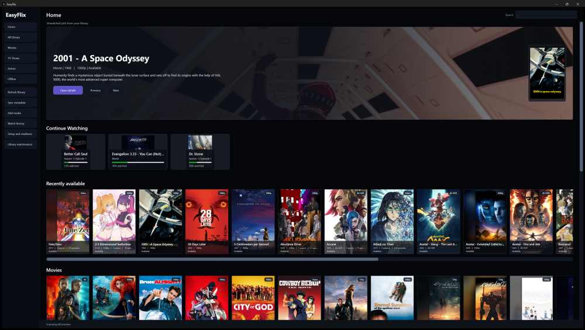
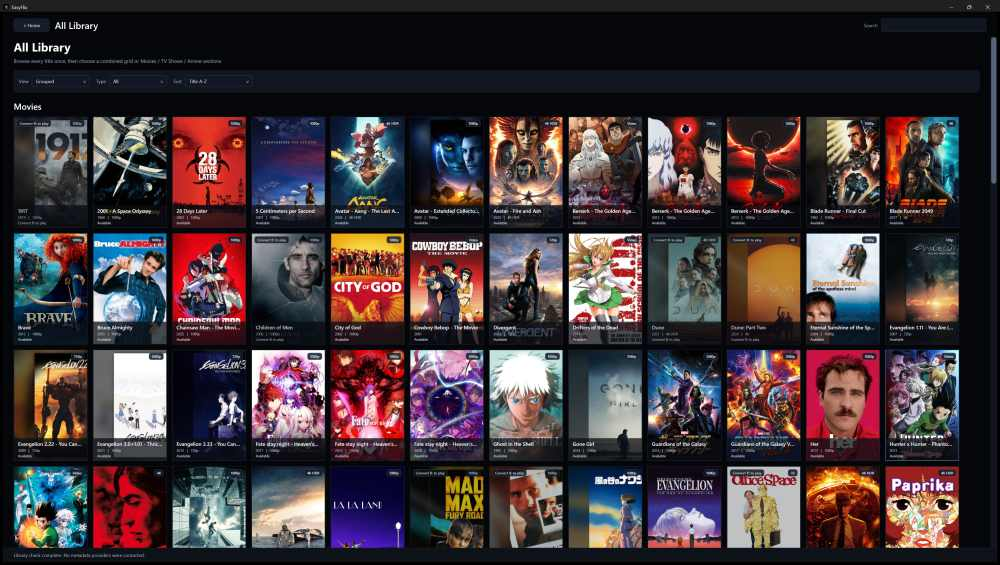
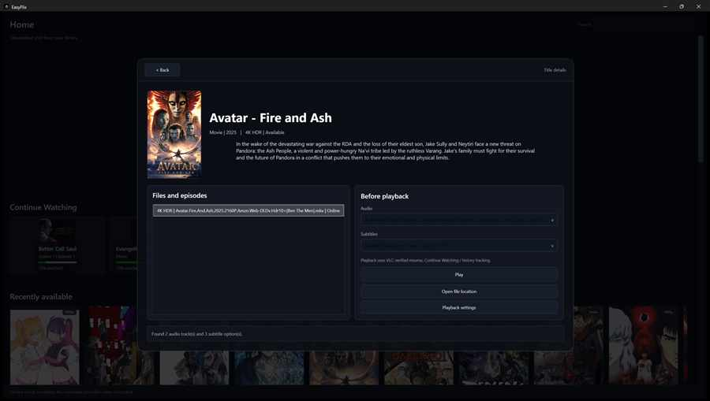

# EasyFlix

EasyFlix is a local-first Windows media library for movies, TV and anime. It turns an existing multi-drive collection into a polished streaming-style interface while keeping the filesystem authoritative and leaving the original media files in place.



## What it does

- Browses Movies, TV and Anime from existing local folders without reorganizing the source files.
- Keeps removable and offline media represented instead of dropping titles when a drive disconnects.
- Uses a rebuildable SQLite catalog while the filesystem remains the source of truth.
- Applies conservative metadata and artwork matching, rejecting weak matches instead of guessing.
- Tracks playback progress, resume state, Continue Watching, Up Next and Watch History.
- Supports Favorites / Watchlist plus manual watched and unwatched controls.
- Provides an Add Media Center and deterministic automation through:
  `EasyFlix.exe --import-handoff "<handoff-path>"`
- Supports the dedicated `.easyflixhandoff` file association.
- Ships as a native per-user Windows installer and a self-contained portable executable.
- Has no runtime LLM dependency.

## Local-first and non-destructive

Normal EasyFlix browsing and refresh operations do not move, rename, remux, recompress or delete your media. The application layers local catalog state, metadata, artwork, playback state and automation on top of the filesystem you already own.

Disconnected storage is represented explicitly as Online, Offline or Missing so removable-drive libraries remain understandable even when a disk is not attached.

## Screenshots

### Library



### Details



## Download

The recommended option for most users is the per-user installer:

- `EasyFlix-Setup-1.4.0.exe`

A self-contained portable build is also available:

- `EasyFlix-v1.4.0-win-x64.exe`

Both are attached to the [EasyFlix 1.4.0 release](https://github.com/marcelosofficial-ctrl/EasyFlix/releases/tag/v1.4.0).

Verify downloads with `SHA256SUMS.txt`.

### SHA-256

| Asset | SHA-256 |
| --- | --- |
| `EasyFlix-Setup-1.4.0.exe` | `4a8f8bafddf8c131e2b4149f02a4336c270d4f602890d024cee14fcfb45991f5` |
| `EasyFlix-v1.4.0-win-x64.exe` | `5978a4645a065513b21f3749d97b20ec5dee435b04c12133d2b5d1db057b4c8c` |

The current binaries are not code-signed. Windows may therefore show normal warnings for an unsigned application downloaded from the internet.

## Add Media automation

The GUI and command-line handoff flow share the same trusted backend.

Canonical flow:

`validate -> backup -> local Refresh -> import -> local Refresh -> final verification -> deterministic result/report`

For local tools or AI agents:

```text
EasyFlix.exe --import-handoff "C:\path\to\media.easyflixhandoff"
```

EasyFlix uses `.easyflixhandoff` for its dedicated association and does not take over generic `.txt` files.

See [docs/ADDING_MEDIA.md](docs/ADDING_MEDIA.md) and [docs/AI_MEDIA_INTAKE_PROTOCOL.md](docs/AI_MEDIA_INTAKE_PROTOCOL.md).

## Architecture

- C# / .NET 10
- WPF desktop UI
- SQLite local catalog and state
- Filesystem-authoritative discovery
- Cached metadata and artwork
- Multi-drive Online / Offline / Missing state
- Windows per-user installer
- Self-contained win-x64 portable build

The source is organized into:

- `src/EasyFlix.App` - desktop UI and Windows integration
- `src/EasyFlix.Core` - catalog, scanning, identity, playback and safety logic
- `src/EasyFlix.Setup` - native installer
- `tests/EasyFlix.Core.Tests` - automated regression and contract coverage

## Validation

The public 1.4.0 snapshot comes from the privacy-sanitized release candidate that completed:

- 219/219 automated tests
- Release build validation
- native installer/package validation
- isolated install/uninstall validation
- public-path/privacy checks
- exact installer and portable SHA-256 verification

The GitHub workflow in this repository is deliberately manual-only through `workflow_dispatch`. Local validation remains the normal development path.

## Privacy and safety boundaries

EasyFlix keeps user catalog state, settings, history, Favorites, playback progress and provider credentials in per-user local state. Those runtime files are not part of this repository or release package.

Provider credentials are stored for the current Windows user. Legacy ReelShelf state remains readable for migration compatibility.

This public repository is a sanitized current snapshot. The private development Git history is intentionally not published because historical development commits contained machine-specific test examples that are not needed by users or contributors.

## Known boundaries

EasyFlix is a local Windows media library, not a cloud streaming service or media server. It does not distribute media and does not make the application the authority over the user's underlying files.

## Build from source

Requirements:

- Windows
- .NET 10 SDK

Build and test:

```powershell
dotnet restore EasyFlix.slnx
dotnet test EasyFlix.slnx -c Release
dotnet build EasyFlix.slnx -c Release
```

## License

EasyFlix source code is released under the MIT License. See [LICENSE](LICENSE).
